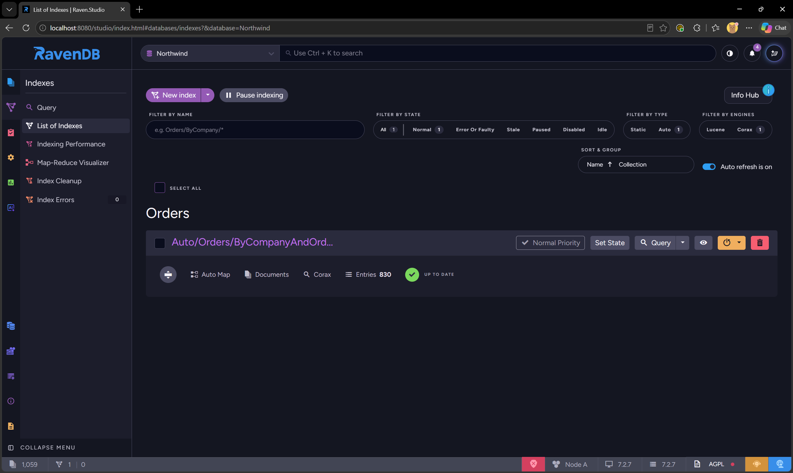

# Unit 2, Lesson 1 - Getting started with indexes

## Every Query Uses an Index

What does it mean? In Unit-1 you wrote a query similar to the following:

````csharp
var orders = (
    from order in session.Query<Order>()
    where order.Company == "companies/1-A"
    orderby order.OrderedAt
    select order
    ).ToList();
````

Remembering RQL syntax:

```sql
from Orders
where Company = "companies/1-A"
order by OrderedAt
```

You might assume that the following pseudo code is run in the server side. Am I right?

````csharp
//..
var results = new List<Order>();

foreach (var o in GetDocumentsFor("Orders"))
{
    if (o.Company == "companies/1-A")
        results.Add(o);
}

var orderedResults = results.Sort((a,b) => a.OrderedAt.CompareTo(b.OrderedAt));
// ..
````

This approach is called a *full scan* (or a *table scan* in relational databases): every
document is checked against the predicate. That works fine for a small number of documents,
but it gets slower and slower as your data grows.

## RavenDB Uses Indexes to Speed Up the Queries

RavenDB doesn't do this. Even when you don't create an index, RavenDB uses one to run the query.
Looking up a value in an index takes roughly *O(log N)* time, instead of the *O(N)* time
needed to check every document, so queries stay fast as the collection grows.

Whenever you run a query, the query optimizer looks for a suitable index.
**If there isn't one, the query optimizer creates an index for you** (an *auto index*)
and uses it for this query and for similar queries later.

## Exercise 1: Confirming that index can be automatically created
In this lesson you will confirm that RavenDB creates indexes automatically when it
is needed.

### Step 1: Access Northwind database using the Management Studio

Start RavenDB console (if you didn't do it yet), and using the web browser, access the
`RavenDB Management Studio` at the address `http://localhost:8080` (which is the
default address. Change it if you need). Then open the `Northwind` database which you
created in the previous unit ([Lesson 1](../../unit1/lesson1/README.md)).

### Step 2: Delete all the existing indexes
In the left panel, select the `Indexes` section. Then, select all indexes and then click 
on the `Delete` button.



### Step 3: Create and execute a program which will perform a query

We could do the following query directly from RavenDB Management Studio. 

```sql
from Orders
where Company = "companies/1-A"
order by OrderedAt
```

Let's make it more interesting.

Create a new Console Application, add the proper NuGet RavenDB reference (`RavenDB.Client`), then change the `Program.cs` content to the following:

````csharp
using System;
using System.Linq;
using Raven.Client.Documents;

namespace IndexingSample
{
    class Program
    {
        static void Main()
        {
            using (var session = DocumentStoreHolder.Store.OpenSession())
            {
                var ordersIds = (
                    from order in session.Query<Order>()
                    where order.Company == "companies/1-A"
                    orderby order.OrderedAt
                    select order.Id
                    ).ToList();

                foreach (var id in ordersIds)
                {
                    Console.WriteLine(id);
                }
            }
        }
    }

    public static class DocumentStoreHolder
    {
        private static readonly Lazy<IDocumentStore> LazyStore =
            new Lazy<IDocumentStore>(() =>
            {
                var store = new DocumentStore
                {
                    Urls = new[] { "http://localhost:8080" },
                    Database = "Northwind"
                };

                return store.Initialize();
            });

        public static IDocumentStore Store =>
            LazyStore.Value;
    }

    public class Order
    {
        public string Id { get; set; }
        public string Company { get; set; }
        public DateTimeOffset OrderedAt { get; set; }
    }
}
````
Note that the `Order` class only has the properties this example needs. That's safe: when you
load a document, change it and call `SaveChanges`, `Raven.Client` keeps the properties that are
not in your class instead of removing them from the stored document. You can change this
behavior with the `PreserveDocumentPropertiesNotFoundOnModel` convention.

### Step 4: Run the program

### Step 5: Confirm that a new index was automatically created

Return to the `Management Studio` and go to the `Indexes/List of Indexes` section. Surprise! A new
index named `Auto/Orders/ByCompanyAndOrderedAt` was created for you.

RavenDB chooses good names for "auto created indexes".

## Great Job!

**Let's move onto [Lesson 2](../lesson2/README.md) and learn how to create and index on your own.**
