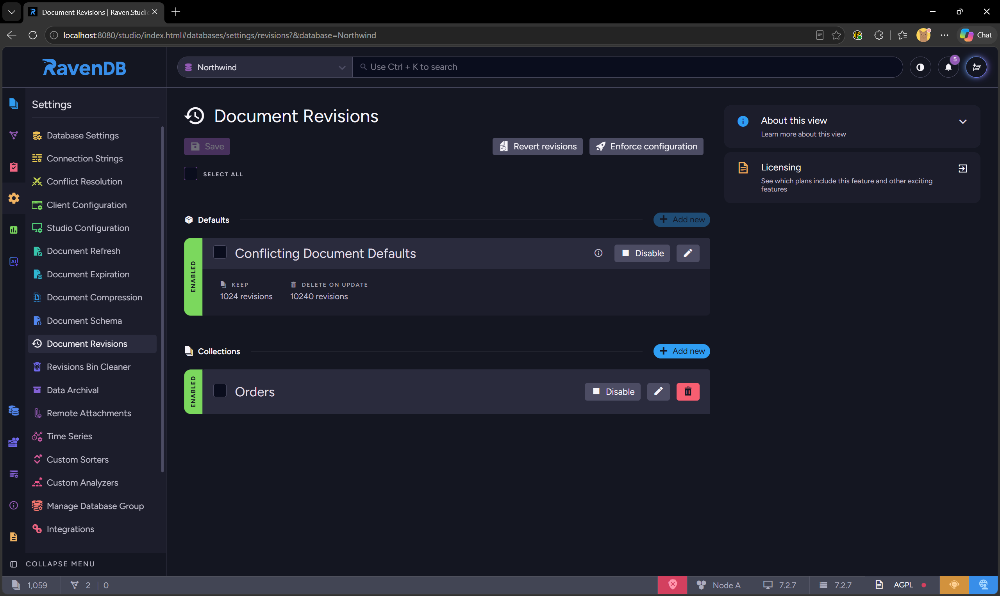
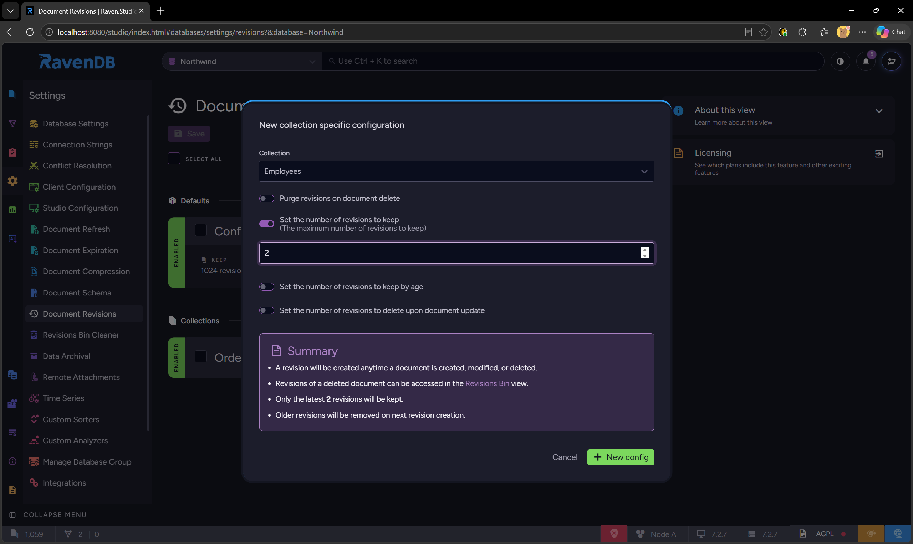
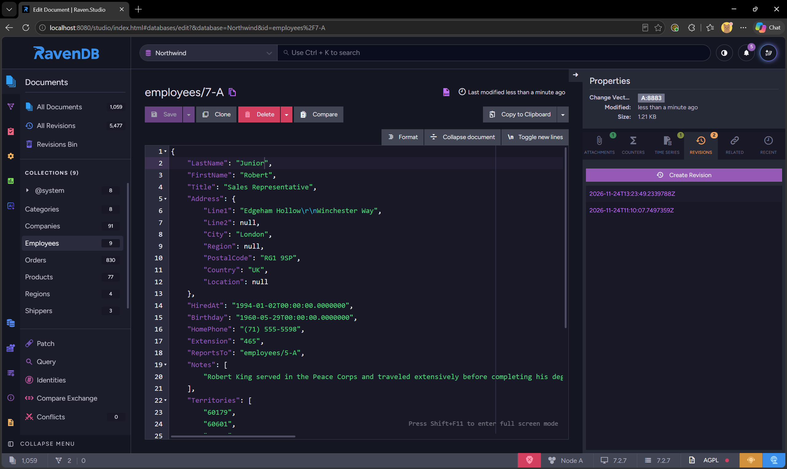

# Unit 3, Lesson 1 - Revisions

Hello and welcome to Unit 3. You already know the basics of using RavenDB. It is time to get started using some more advanced features.

In this lesson you will learn how to enable document revisions on your databases.

## What are Revisions?

When revisions are enabled, every time you create, update, or even delete a document, RavenDB stores a snapshot (revision) of it. This is useful when you need to track the history of your documents or keep a full audit trail.

You can choose to keep track of the last N revisions. If necessary, you could "track everything".

## How to Enable Revisions

You can configure revisions in the Studio, under `Settings` → `Document Revisions`:



There are two kinds of configurations:

* **Defaults** apply to every collection that doesn't have its own configuration.
* **Collections** configurations apply to one collection and override the defaults.

RavenDB only creates revisions for documents covered by an enabled configuration. If you loaded
the sample data, you will already see a configuration for the `Orders` collection, and the
`Conflicting Document Defaults`, which only apply to documents in conflict.

Each configuration has these options:

*   **Purge revisions on document delete**: delete a document's revisions when the document is deleted.
*   **Set the number of revisions to keep**: keep only the latest N revisions.
*   **Set the number of revisions to keep by age**: keep revisions for a minimum time before they can be removed.
*   **Set the number of revisions to delete upon document update**: limit how many old revisions are removed at once when a document is updated.

You can also configure revisions programmatically, following the [online documentation](https://docs.ravendb.net/7.2/document-extensions/revisions/overview).

## Exercise: Enable revisions for the `Employees` collection

Let's start by enabling revisions for the `Employees` collection.

### Step 1: Open the Northwind database
Open the `RavenDB Management Studio`, then open the Northwind database.

### Step 2: Open the `Document Revisions` view
In the left panel, select `Settings`, then `Document Revisions`.

### Step 3: Set up revisions for the Employees collection

* In the `Collections` section, click `Add new`. (The `Defaults` section has its own `Add new`
  button, which would create a configuration for all collections.)
* Select the `Employees` collection.
* Enable `Set the number of revisions to keep` and enter 2. (Without a license, RavenDB runs
  under AGPL and allows at most 2 revisions here. With a free
  [Developer license](https://ravendb.net/license/request/dev) you can keep more.)
* Click `New config`.
* Click `Save` at the top of the page.



You can test revisions by editing a document directly in the Studio. Edit any Employee document,
save it, and open the `Revisions` tab on the right to see the list of revisions.



## Retrieving Revisions from a Document

Retrieving revisions for a document is pretty simple.

```csharp
static void Main(string[] args)
{
    using (var session = DocumentStoreHolder.Store.OpenSession())
    {
        var revisions = session.Advanced.Revisions
            .GetFor<Employee>("employees/7-A");

        foreach (var revision in revisions)
        {
            // process revision
        }
    }
}
```

## Great Job!

**Let's move onto [Lesson 2](../lesson2/README.md).**
