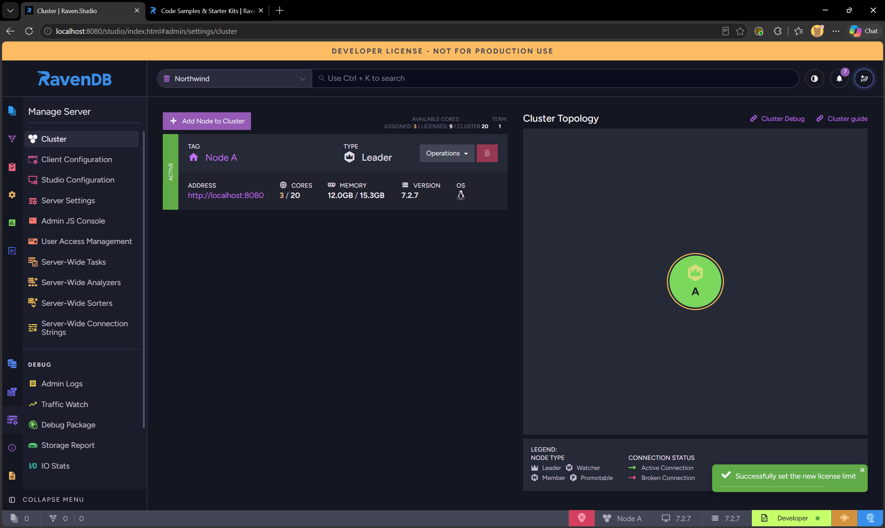
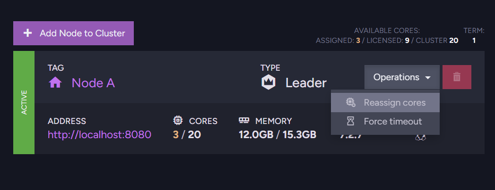
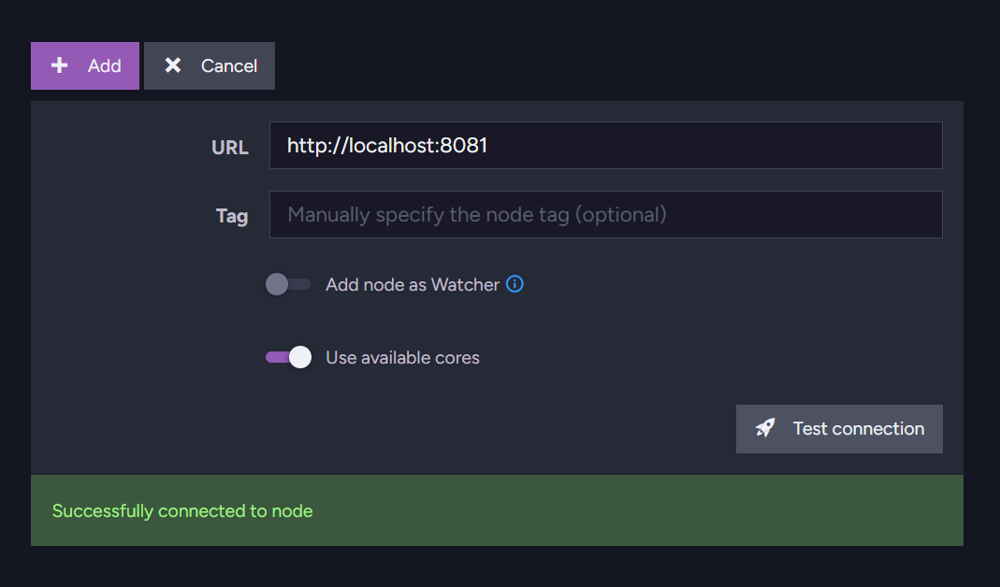
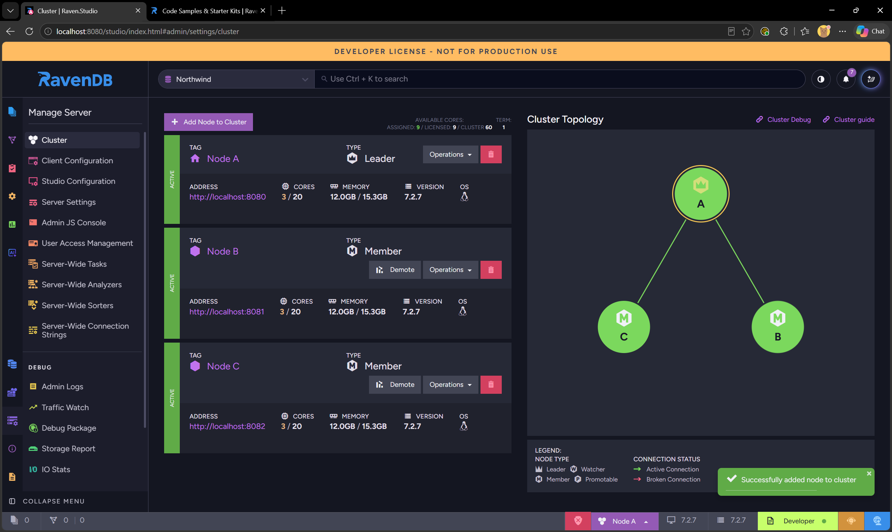

# Unit 4, Lesson 1 - Setting up your first cluster

Now it is time to start learning about how to use clusters.

It is not a difficult task. You do not need to be an expert to manage a RavenDB cluster (We did our best to make it mostly self-managed).

## The Point of Setting up a Cluster

A RavenDB cluster is a set of machines that have been joined together. Each machine in the cluster is a node.

When you create a database, it can live on a single node (one machine in the cluster), some number of the nodes, or even all the nodes. Each node will hold a complete copy of the database and will be able to serve all queries, operations, and writes. RavenDB cluster implements [multi-master replication](https://en.wikipedia.org/wiki/Multi-master_replication).

The primary reason for this duplicating data is to allow high availability. If a node goes down, the cluster will still have copies of the data and can shuffle things around so clients can talk to another node without realizing that anything happened.

The cluster can distribute the work, handle the failures, and adopt recovery procedures automatically.

## Let’s Set up a Cluster

If you have the RavenDB server running on your computer, you are already using a cluster. It's a cluster with a single node, but it is still a cluster.



What you need to do is add more nodes to your cluster.

## Can We Simply Add Nodes to a Cluster?

Yes, but you need a license. Without one (AGPL), RavenDB doesn't allow adding nodes to a cluster.
If you haven't done it yet, register the free Developer license (see [Unit 1, Lesson 1](../../unit1/lesson1/README.md#getting-a-free-developer-license)).

Licenses also limit how many CPU cores the whole cluster can use. The Developer license allows 9
cores in total, and each node gets a share of them. You can see the numbers at the top of the
`Cluster` view (`Manage Server` → `Cluster`): how many cores are assigned, licensed, and available
in the cluster.

With three nodes you usually don't need to change anything. But if a new node can't get enough cores,
you can lower the number of cores another node uses: in the list of nodes, click `Operations` and
then `Reassign cores` on that node.



## Exercise: Starting the second node

In this exercise you will learn how to add a second node to the cluster.

### Step 1: Starting a second server instance

Let’s start a second instance of the RavenDB server. Typically you would do that on a separate machine, but to make this exercise easier we’ll run it on the same computer.

#### If you run RavenDB in Docker

The nodes need to reach each other at the same addresses that your browser and your code use. The
easiest way to get that is Docker's host networking: every node listens on its own port of your
machine (`8080`, `8081`, `8082`).

> Host networking works out of the box on Linux and in WSL 2. On Docker Desktop for Windows or macOS,
> turn it on first: `Settings` → `Resources` → `Network` → `Enable host networking`.

First, recreate the container from Unit 1 so that the first node (node A) uses host networking too.
Your databases and your license are stored in the volumes, so you won't lose them:

```
docker rm -f ravendb
```

```
docker run -d --name ravendb --network host -e RAVEN_Setup_Mode=None -e RAVEN_License_Eula_Accepted=true -e RAVEN_Security_UnsecuredAccessAllowed=PublicNetwork -e RAVEN_ServerUrl=http://127.0.0.1:8080 -e RAVEN_ServerUrl_Tcp=tcp://127.0.0.1:38888 -e RAVEN_PublicServerUrl=http://localhost:8080 -e RAVEN_PublicServerUrl_Tcp=tcp://localhost:38888 -v ravendb-data:/var/lib/ravendb/data -v ravendb-config:/etc/ravendb ravendb/ravendb
```

Then start the second node on port `8081`, with its own volumes:

```
docker run -d --name ravendb-b --network host -e RAVEN_Setup_Mode=None -e RAVEN_License_Eula_Accepted=true -e RAVEN_Security_UnsecuredAccessAllowed=PublicNetwork -e RAVEN_ServerUrl=http://127.0.0.1:8081 -e RAVEN_ServerUrl_Tcp=tcp://127.0.0.1:38889 -e RAVEN_PublicServerUrl=http://localhost:8081 -e RAVEN_PublicServerUrl_Tcp=tcp://localhost:38889 -v ravendb-b-data:/var/lib/ravendb/data -v ravendb-b-config:/etc/ravendb ravendb/ravendb
```

What the new options do:

* `RAVEN_ServerUrl` and `RAVEN_ServerUrl_Tcp` set the addresses the server listens on. `127.0.0.1`
  means only your own machine can connect.
* `RAVEN_PublicServerUrl` and `RAVEN_PublicServerUrl_Tcp` set the addresses the node tells the
  other nodes and the clients to use.
* `RAVEN_Security_UnsecuredAccessAllowed=PublicNetwork` allows the unsecured server to accept these
  connections. It is still only reachable from your machine, because it listens on `127.0.0.1`.

#### If you run RavenDB directly on Windows

Open a new terminal session and run the following command:

<div style="font-family: monospace; word-wrap: break-word; word-break: break-all;">.\Server\Raven.Server.exe --ServerUrl=http://127.0.0.2:8080 --ServerUrl.Tcp=tcp://127.0.0.2:38888 --Logs.Path=Logs/B --DataDir=Data/B</div>

We are specifying the server http address as `http://127.0.0.2:8080` and the tcp address as `tcp://127.0.0.2:38888`. The logs directory is `Logs/B` and the data directory is `Data/B`.

**Now there are two servers running on your computer**.

### Step 2: Add the second server as a node in the cluster

Open the `Management Studio` from the first server, then, in the left panel, select `Manage Server` and then `Cluster`. Click on `Add Node to Cluster`. Enter the URL of the second server (`http://localhost:8081` with Docker, `http://127.0.0.2:8080` on Windows) and click on `Test connection`. Leave `Use available cores` turned on.



Success? Click on `Add`.

## Exercise: Starting the third node

I strongly recommend you to repeat the process to create the third node. With Docker, start a container named `ravendb-c` on port `8082` (TCP port `38890`) with volumes `ravendb-c-data` and `ravendb-c-config`, and add it as `http://localhost:8082`. On Windows, use `http://127.0.0.3:8080`, with data at `Data/C` and logs at `Logs/C`.

This is our result:



In a future lesson, you will learn why it makes little sense to setup a cluster with only two nodes.

## Some New Important Concepts

Now that you know what is a cluster, it's time to learn some new concepts. 

* Database – the named database we’re talking about,  regardless of whether we’re speaking about a specific instance or the whole group.
* Database Instance – exists on a single node.
* Database Group – the grouping of all the different instances, typically used to explicitly refer to its distributed nature.
* Database Topology – the specific nodes that all the database instances in a database group reside on in a particular point in time.

Consider you have a cluster with 5 nodes. It is possible to create a database setting with a replication factor of just 3. In this case, only 3 nodes will have instances of the database. The selected nodes will form the Database Topology and all the three instances will constitute the Database Group. 

## Great Job!

In the next lesson I will help you to create a database, set the replication factor, and define what nodes will compose the Database Topology.

**Let's move onto [Lesson 2](../lesson2/README.md).**